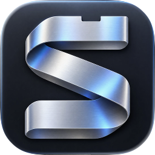
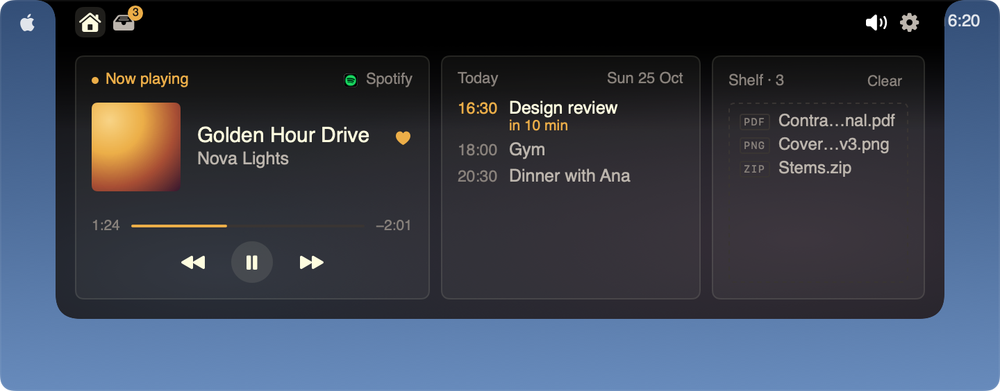
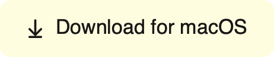

  

<h1 align="center">Super Notch</h1>

  <b>Your notch, put to work.</b> 
  What's playing, what's next and what you're carrying — right where your eyes already go.

  

  

Free · macOS 26 · a Mac with a notch

## Requirements

- macOS 26 or later.
- A Mac with a notch: a MacBook Air or MacBook Pro whose screen has the notch.

## Install

1. Download `SuperNotch.dmg`, open it and drag Super Notch to Applications.
2. Open Super Notch. macOS says it can't check it for malware: click **Done**.
3. Open **System Settings → Privacy & Security**, scroll down, click **Open Anyway** next to Super Notch, and enter
   your password.

You do this once. Super Notch isn't notarized by Apple yet; its updates install without asking again.

## What it does

Hover over the notch to peek, click to open it.

**Works with**

- **Spotify** — what's playing, its controls, and the heart and your playlists.
- **Music** — what's playing in Apple's Music app, with its controls.
- **YouTube and more in your browser** — the song or video playing in a tab.

**And**

- **Calendar & meeting nudges** — today's events and reminders, and a nudge with a Join button before a meeting.
- **Shelf for files** — drop files on the notch to keep them at hand, then drag them out where they're needed.
- **Volume & brightness** — the keys show their level in the notch.
- **Notification icons** — the app icon of a new notification, beside the notch.
- **Timer & weather** — a focus timer, the weather and the time in other cities, in and beside the notch.
- **Lock screen music** — what's playing, with its controls, on the lock screen.

Each one can be turned off, and Settings has the rest: menu bar icon → **Settings…**

## Spotify

Optional: music works without it. The heart and your playlists need Spotify Premium and your own free Spotify
developer app. The welcome guide walks you through it in about two minutes.

## Privacy

Everything is read on your Mac. Super Notch goes online only for:

- Spotify's Web API, if you connect it;
- Spotify's image servers, for the cover of the song that's playing and your playlists' covers;
- Open-Meteo, for the weather and the city search;
- Apple, for your city's name when the weather uses "This Mac";
- GitHub, for the daily update check.

No analytics, no account.

## Updates

Super Notch checks for an update once a day and downloads it in the background. It asks before it restarts; if you
choose Later, it updates the next time it quits. After an update, the notch tells you what's new.

## Report a bug

Menu bar icon → **Report a Bug…** fills in your Mac's details for you. You can also
[open an issue](https://github.com/NM193/super-notch/issues/new/choose) or write to
supernotch@nemanjamarjanovic.com.

## Support

Super Notch is free, with no ads. If you like it, [buy me a coffee on Ko-fi](https://ko-fi.com/nemanjamarjanovic).

## Other notch apps

Quit Boring Notch, NotchNook and the like before you open Super Notch: two notch apps fight over the notch.

---

Copyright © 2026 Nemanja Marjanovic. All rights reserved.
